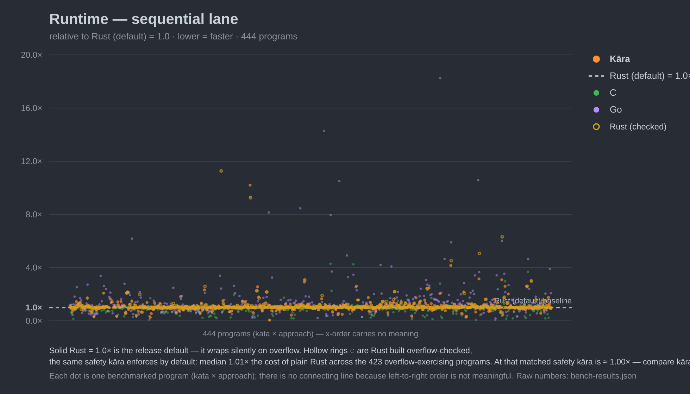
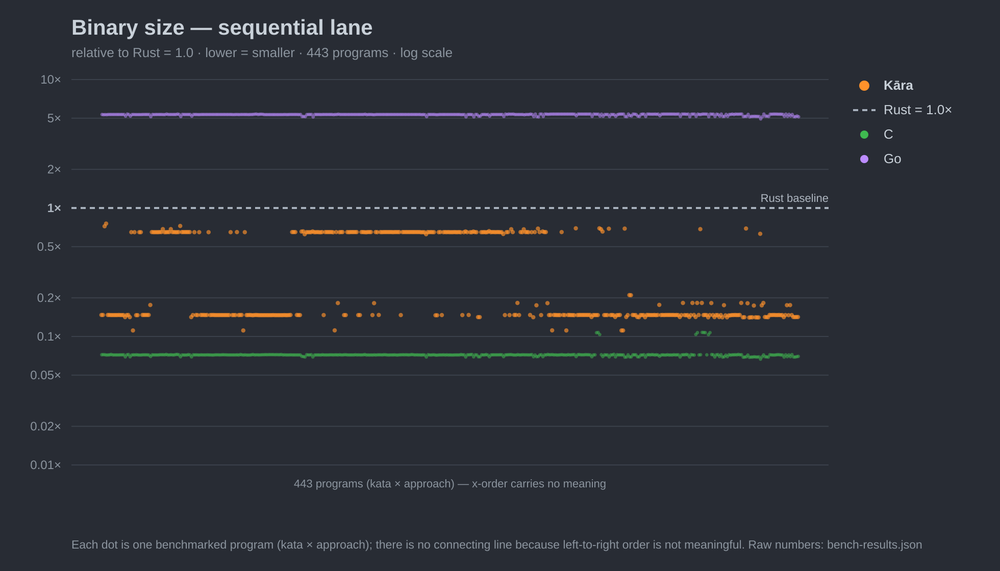
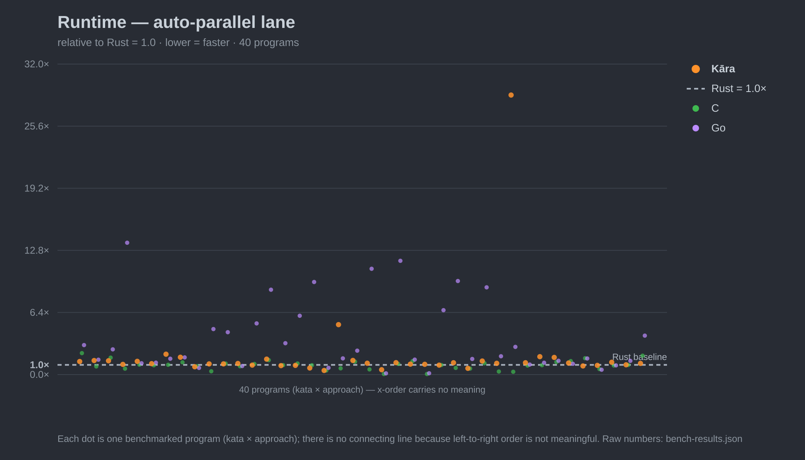

# Kāra Katas

Classic algorithm problems (LeetCode-style) implemented in **[Kāra](https://github.com/karalang/kara)** and mirrored, algorithm-for-algorithm, in **C, Rust, Go, and Python**. The corpus does double duty: it exercises the Kāra compiler against real code, and it benchmarks Kāra's compiled output against mainstream languages on identical workloads.

Kāra is a young systems language. The point of the charts below is narrow and honest: on most of these problems, Kāra's compiled output lands *in the pack* with C, Rust, and Go, and the charts show the programs where it doesn't.

## Runtime — sequential lane

Single-threaded, same algorithm in every language, native binaries (`karac build` / `rustc -O` / `clang -O3` / `go build`). Each dot is one benchmarked program; lower is faster; everything is relative to Rust = 1.0. The dots aren't connected by a line because left-to-right order is meaningless — read it as a distribution, not a trend.



Across **419 programs** (414 katas, measured on an M5 Pro on the current compiler, 2026-10-29 to 2026-11-07), Kāra's median is **1.04× default Rust**, **1.17× C** and **0.94× Go**; 261 programs land within 10% of Rust. One thing to read deliberately: Kāra **checks integer overflow by default** and `rustc -O` **silently wraps** — defined behavior, but a wrong value where Kāra would trap — so the gray **Rust (default)** baseline is doing strictly less work than Kāra on overflowing arithmetic. The goldenrod **Rust (checked)** rings overlay `rustc -O -C overflow-checks=on` — the safety-matched build — on the 398 programs where it differs: there Kāra's median is **1.00×**, with 303 of 398 within 10%. It is not uniform: 21 programs are more than 2× default Rust, the worst being #163 missing ranges (10.2×), #364 (4.2×), #390 (3.2×) and #411 (3.1×); against checked Rust the worst is #170 (3.1×). The chart shows every one of those plainly. See [BENCHMARKS.md](BENCHMARKS.md) for the full caveat.

## Binary size



Kāra's median binary is **~296 KiB** (quartiles ~67 KiB and ~296 KiB, depending on how much runtime a program pulls in: hash maps, strings). That is above C's ~33 KiB, below Rust's ~456 KiB on every one of the 418 programs, and about **8× smaller than Go** (~2.4 MiB), which carries its runtime + GC in every binary.

## Parallel lane — auto-par vs hand-tuned

This is the one thing Kāra does that the others don't hand you for free. The katas below have a data-parallel reduction over their workload; Kāra's compiler parallelizes it automatically from the **same single-threaded source**, while the Rust/Go/C mirrors had to be *rewritten* by hand — Rust pulls in the `rayon` crate and an `.into_par_iter()`, Go hand-rolls goroutine chunking + a `WaitGroup` + a merge, C raw `pthread_create`/`join`. Each dot is one program; lower is faster; relative to Rust = 1.0.



> **Being re-measured (2026-11-07):** 33 of these 40 programs' Kāra figures predate a fix (karac 57efe5bc2f) that removed a lock every parallel task contended on, so the numbers below, #133's especially, are stale until the M5 re-run lands.

The result across **40 programs** with a full parallel comparator set: Kāra's auto-par — **from single-threaded source, zero parallel code** — runs at a **median 1.16× of hand-tuned `rayon`**, and is **faster than `rayon` on 11** of them (best: #22 0.43×, #57 0.50×, #86 0.64×, #20 0.67×). Against Go's hand-rolled goroutines it wins on **25 of 40**. Against raw `pthread_create`/`join` C it matches or beats the metal floor on 13 (#273 0.53×, #3629 0.59×, #1 0.61×). It is **not** uniformly fast, and the misses are large: #9 is 2.1× `rayon`, #23 divide-and-conquer 5.1×, and #133 clone-graph BFS **28.8×** `rayon` (~100× C); #71 simplify is ~18× C. The chart shows every one. The point isn't "beats rayon" — it's **competitive throughput on most of these for none of the cost**: no crate, no `.into_par_iter()`, no `unsafe`/`Send`/`Sync` reasoning, no `WaitGroup`, and no data-race, goroutine-leak, or partial-merge bug class to chase. The compiler's cost gate also *declines* to parallelize loops too small to pay off, so this lane only includes katas where the reduction is heavy enough to matter.

## The rest of the picture

Four more charts — compile time, compile memory, runtime memory, and Kāra's intra-language auto-par speedup (same source, parallel ÷ sequential) — plus the methodology live in **[BENCHMARKS.md](BENCHMARKS.md)**.

## What these numbers are — and aren't

- **Same algorithm, same workload** per program, across all languages. The comparison is of *compiled output and runtime quality*, not of who can write the cleverest solution.
- These are **single-file algorithm kernels**, not whole applications. They measure codegen and runtime behavior on tight loops; they do **not** claim to predict real-world application performance.
- **Wall-time numbers are noise-limited** (measured on a shared M5 Pro under load, across several compiler builds from 2026-10-29 on; 289 of the 414 katas predate the compiler's move to LLVM 22 on 2026-11-04) — treat them as approximate and read the *shape*, not the third digit. The deterministic metrics (binary size, peak memory) are stable run-to-run.
- Raw data for every chart lives in **[`bench-results.json`](bench-results.json)**; the measurement protocol is **[BENCH.md](BENCH.md)**.

## Reproducing

Each kata ships a `bench/bench.sh` that builds every language's mirror, checks they all print the same result, then times and measures them:

```bash
brew install hyperfine          # also needs karac, rustc, clang, go
cd leetcode/1-100/1-two-sum/bench && ./bench.sh   # writes bench/results.json

./scripts/consolidate-bench.sh  # merge all per-kata results → bench-results.json
python3 scripts/bench-graph.py  # redraw graphs/*.svg from the consolidated feed
./scripts/render-png.sh         # graphs/*.svg → graphs/*.png (GitHub embeds these)
```
